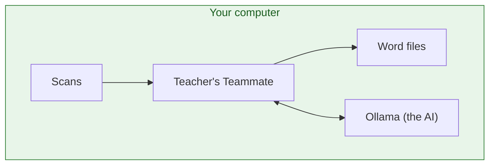
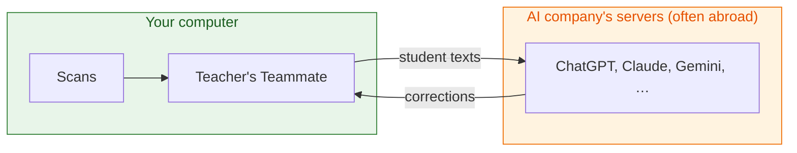
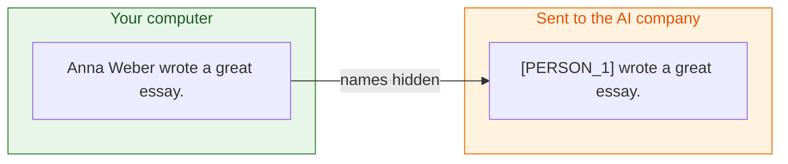

# Teacher's Teammate

<div align="center">
  
</div>

Teacher's Teammate reads your scanned documents — PDFs, photos, images, or plain text files —
and turns handwriting or printed text into editable text, saved as proofread Word documents
(DOCX). It handles the full digitization workflow: text recognition (OCR), optional removal of
personal data before anything is sent to a cloud service, AI-based proofreading, and an
evaluation of the corrections.

Everything can run locally on your computer. The app comes as a desktop application and a
command-line tool.

---

## Installation

Download the installer for your platform from the
[releases page](https://github.com/JoHoenk/teachers-teammate/releases) and run it. Then launch
**Teacher's Teammate** from the Start menu (Windows), the Applications folder (macOS), or with
`teachers-teammate-gui` from a terminal.

Prefer Python? Each release also ships a wheel:

```bash
pip install teachers_teammate-<version>-py3-none-any.whl
```

Optional components — privacy protection (spaCy), PaddleOCR, GPU monitoring, and spaCy
language models — can be installed from inside the app; no terminal required.

## Set up text recognition

Teacher's Teammate uses [Ollama](https://ollama.com) for OCR by default — a local AI runtime
that keeps your documents on your machine. Install it from
[ollama.com/download](https://ollama.com/download) if it isn't running yet.

Then open **Advanced Settings → Downloads…** in the app, click **Select the best models for my
computer**, and **Install / Download Selected**. Alternatively, pull a model yourself:

```bash
ollama pull deepseek-ocr:latest
```

Set your input and output folders and click **Run Selected**. Your settings are saved and
restored on the next launch.

**Always keep text recognition on your own computer.** To read a page, the AI needs the page
itself: the handwriting, the student's name at the top, the grade in the margin. None of that can
be hidden beforehand, because names can only be found once the text has been read. So even if you
use an online service for proofreading, leave text recognition on Ollama.

## Why local AI protects your students' privacy

Student work is personal: names, handwriting, grades, sometimes notes about health or family.
Where the AI runs decides who gets to see it.

**With Ollama, everything stays on your computer.** The AI runs on your own machine, like any
other program. Your scans are read and proofread there, and the Word documents are saved there.
Nothing is uploaded, so no company can store, analyse, or leak your students' texts — and it
even works without an internet connection.



*Nothing leaves your computer.*

**With an online AI service** (such as ChatGPT, Claude, or Gemini), the texts have to travel to
the company's servers to be processed — often in another country. You then depend on that
company's promises about what happens to the data: how long it is kept, who can access it, and
whether it is used to train future AI models. For pupils' work, that is usually hard to square
with your school's data protection rules.



**If you do want an online service** — for example because its proofreading is better — turn on
**privacy protection** in the app. Teacher's Teammate then replaces names, email addresses, and
phone numbers with placeholders *before* anything is sent, and puts the real names back on your
computer afterwards:



Teacher's Teammate always shows where each step runs — a box at the top of the settings panel — and asks you to confirm before a run that sends anything away from your computer.

This greatly reduces what leaves your computer, but no automatic tool catches every name.
Check the result with **Personal Information Preview…** before sending sensitive documents, and
follow your school's data protection guidelines. When in doubt, stay local.

## Command line

```bash
# Process a folder and write DOCX reports
teachers-teammate -i scans/ -o output/ --docx

# All options
teachers-teammate --help
```

Without `--docx`, only the per-file processing state is written.

---

## Documentation

| Guide | Contents |
|---|---|
| [Overview](https://github.com/JoHoenk/teachers-teammate/blob/main/docs/index.md) | What the app does, how it works, getting started |
| [Using the app](https://github.com/JoHoenk/teachers-teammate/blob/main/docs/using_the_app.md) | Step-by-step guide to the desktop app |
| [Advanced user guide](https://github.com/JoHoenk/teachers-teammate/blob/main/docs/advanced_user_guide.md) | OCR engines, preprocessing, correction/evaluation, model and provider selection |

Want to help develop Teacher's Teammate? See
[CONTRIBUTING.md](https://github.com/JoHoenk/teachers-teammate/blob/main/CONTRIBUTING.md).

## Credits

- [Ollama-OCR](https://github.com/imanoop7/Ollama-OCR) by imanoop7 — inspired this project
- [Ollama](https://ollama.com) — local LLM inference runtime
- [LangChain](https://github.com/langchain-ai/langchain) — LLM abstraction layer
- [Tesseract OCR](https://github.com/tesseract-ocr/tesseract) — open-source OCR engine

## License

Teacher's Teammate is released under the
[Apache License 2.0](https://github.com/JoHoenk/teachers-teammate/blob/main/LICENSE). It bundles
third-party components, including the Qt toolkit (via PySide6) under the LGPL v3 — see
[NOTICE](https://github.com/JoHoenk/teachers-teammate/blob/main/NOTICE) for details. The full
license texts are also available in the app under **Advanced Settings → About → Third-Party
Licenses**.
