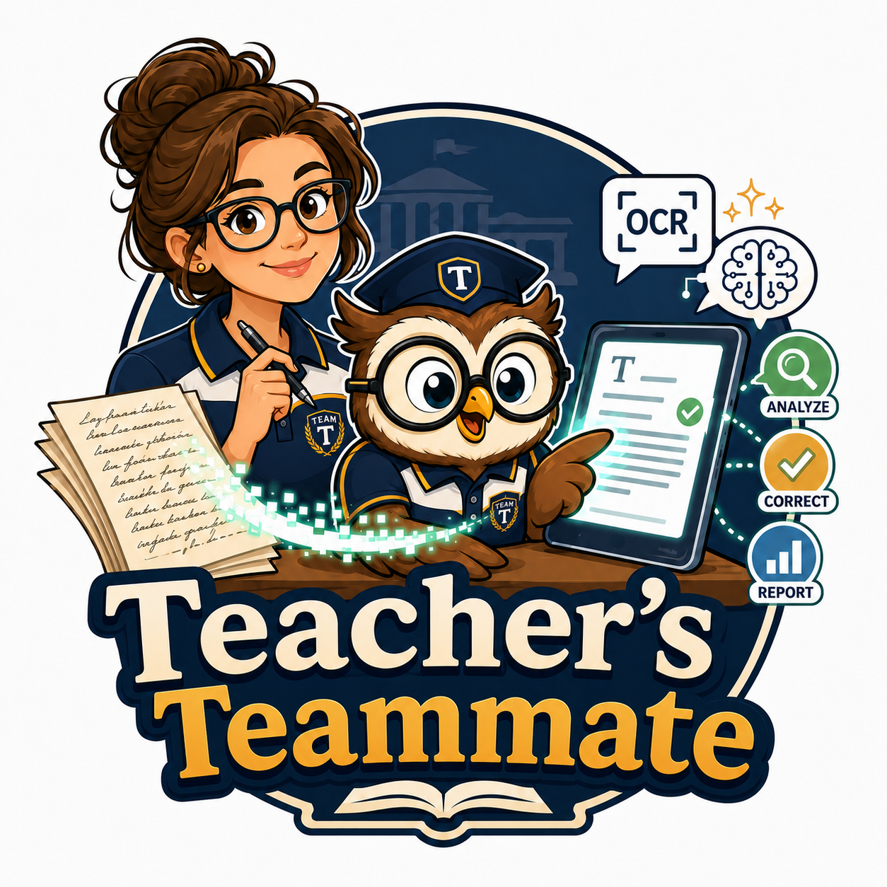

# Teacher's Teammate

<div align="center">
  
</div>

Teacher's Teammate turns scanned and handwritten student work into proofread Word documents.
Give it a folder of PDFs, photos or text files. For each file it can:

- **read** handwriting and printed text,
- **hide** names and other personal data before anything goes to an online service,
- **proofread** the text and explain every correction,
- **review the content** and point out gaps and unclear passages.

Everything can run on your own computer, with nothing uploaded.

## Privacy

| Proofreading with | Where your students' texts go |
|---|---|
| **Ollama** (on your computer) | Nowhere. Everything stays on your computer and works offline. |
| **An online service** (ChatGPT, Claude, Gemini, …) | To the company's servers, often abroad. What happens to them there is up to the company. |

- **Reading the pages always stays on your computer.** A page shows names and grades, and nothing
  can be hidden before it has been read.
- **Privacy protection** replaces names, email addresses, phone numbers and other personal data
  with placeholders before anything is sent, and puts them back on your computer afterwards:
  *Anna Weber wrote a great essay.* → *[PERSON_1] wrote a great essay.*
- The app shows where each step runs and asks before a run sends anything away.
- No automatic tool catches every name. Right-click a file → **What is sent for this file…** to
  check before you send sensitive work, and follow your school's data protection rules. When in
  doubt, stay local.

## Installation

Download from the [releases page](https://github.com/JoHoenk/teachers-teammate/releases):

| System | File | Install |
|---|---|---|
| Windows | `teachers-teammate-<version>-w64-setup.exe` | Run it, then start the app from the Start menu. |
| macOS | `teachers-teammate-<version>-macos.dmg` | Open it and drag the app into Applications. |
| Linux | `teachers-teammate_<version>_amd64.deb` | `sudo apt install ./teachers-teammate_<version>_amd64.deb` |
| Any | `teachers_teammate-<version>-py3-none-any.whl` | The command-line tool, see [Command line](#command-line). |

If Windows or macOS refuses to start the app, see [Code signing](#code-signing).

The built-in reader comes with the app. The AI models for Ollama and privacy protection are
downloaded from inside the app, only when you ask; the app shows the size first.

### System requirements

| | Windows | macOS | Linux |
|---|---|---|---|
| **System** | 10 (1809 or newer) or 11 | 15 Sequoia or newer | Ubuntu 24.04+, Debian 13+, Mint 22+ |
| **Processor** | x64 | Apple Silicon | x86_64 |
| **Memory** | 8 GB | 8 GB | 8 GB |
| **Disk space** | about 700 MB | about 700 MB | about 700 MB |

Each AI model needs another 1.6 to 8 GB of disk space. For Ubuntu 22.04, Debian 12 and Mint 21,
use version 0.5.x.

## Getting started

1. **Install [Ollama](https://ollama.com/download)** (Windows: `winget install Ollama.Ollama`)
   and start it. Ollama runs the AI on your computer.
2. **Run the Setup Assistant.** It opens on the first start (later: **Tools → Setup Assistant…**).
   Answer three questions — your class's language, what your students hand in, where
   proofreading may run — and press **Set up**.
3. **Open the folder with the documents** and click **Run Selected**.

## Command line

The command-line tool needs Python 3.14 and comes as a separate download (the `.whl` file):

```bash
pip install teachers_teammate-<version>-py3-none-any.whl
teachers-teammate -i scans/ -o output/ --docx   # write Word documents
teachers-teammate --help
```

Details: [advanced user guide](https://github.com/JoHoenk/teachers-teammate/blob/main/docs/advanced_user_guide.md#the-command-line).

## Documentation

| Guide | Contents |
|---|---|
| [Overview](https://github.com/JoHoenk/teachers-teammate/blob/main/docs/index.md) | What the app does and how it works |
| [Using the app](https://github.com/JoHoenk/teachers-teammate/blob/main/docs/using_the_app.md) | Step by step through the desktop app |
| [Advanced user guide](https://github.com/JoHoenk/teachers-teammate/blob/main/docs/advanced_user_guide.md) | Reading methods, AI models, image preparation, privacy protection, the command line |
| [Privacy](https://github.com/JoHoenk/teachers-teammate/blob/main/docs/privacy.md) | What the app does with your data |

Developers: see [CONTRIBUTING.md](https://github.com/JoHoenk/teachers-teammate/blob/main/CONTRIBUTING.md).

## Code signing

The installers are not signed. Every release has a `SHA256SUMS` file to check the downloads.

- **Windows** shows "Windows protected your PC": click **More info → Run anyway**.
- **macOS**: **System Settings → Privacy & Security → Open Anyway**.

## Credits

Teacher's Teammate stands on the shoulders of open-source work. Thank you to everyone behind it.

### Where it started

- [Ollama-OCR](https://github.com/imanoop7/Ollama-OCR) by imanoop7 — the project that showed us handwriting could be read locally.

### The engine room

- [Ollama](https://ollama.com) — turns "run an AI on a school laptop" from a project into a download
- [LangChain](https://github.com/langchain-ai/langchain) — one plug for every online AI service
- [PaddleOCR](https://github.com/PaddlePaddle/PaddleOCR) — the pocket-sized reading models inside the built-in reader
- [RapidOCR](https://github.com/RapidAI/RapidOCR) — showed that PaddleOCR's models can leave Paddle's own framework and run anywhere
- [spaCy](https://spacy.io) — the sharp eye that finds a student's name before it can leak into outer space
- [OpenCV](https://opencv.org) — rescues crooked, shadowed phone photos of pages
- [PDFium](https://pdfium.googlesource.com/pdfium/) (via pypdfium2) — opens whatever PDF the scanner produced.
- [python-docx](https://github.com/python-openxml/python-docx) — turns the results into the Word files you hand back

### The models you meet first

- [Chandra OCR](https://github.com/datalab-to/chandra) by Datalab — reads even difficult handwriting 
- [Gemma](https://ai.google.dev/gemma) by Google — proofreads and explains, and fits on an 8 GB graphics card

### The learner texts behind our recommendations

We choose models by testing them on real learner writing:

- [Falko-MERLIN](https://github.com/adrianeboyd/boyd-wnut2018) for German and
- [W&I+LOCNESS](https://www.cl.cam.ac.uk/research/nl/bea2019st/) for English. 

Thanks to the researchers who collected and corrected these texts. They are not part of this repository or the app due to license restrictions.

## License

[GNU General Public License, version 3 or later](https://github.com/JoHoenk/teachers-teammate/blob/main/LICENSE).
Bundled third-party components, including Qt (LGPL v3): see
[NOTICE](https://github.com/JoHoenk/teachers-teammate/blob/main/NOTICE) and **Help → Licenses** in
the app.

The AI models are downloaded from their authors and come under their own licenses. The default
reading model (Chandra OCR 2) is free for research and personal use only; the app says so before
the download.
