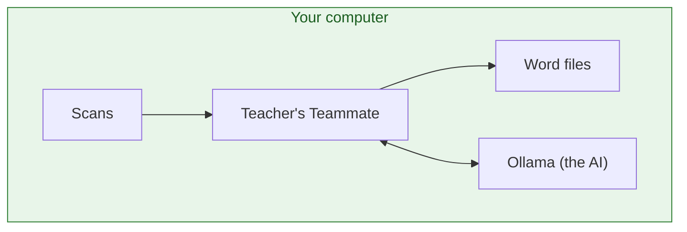
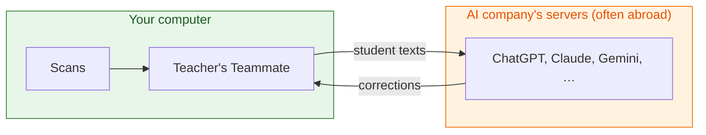
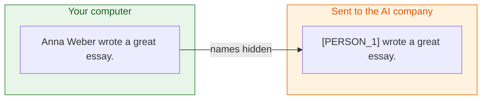

# Teacher's Teammate

<div align="center">
  
</div>

Teacher's Teammate turns scanned and handwritten student work into proofread Word documents
(DOCX). Give it a folder of PDFs, photos, images or text files. For each file it can:

- **read** handwriting and printed text (OCR),
- **hide** names and other personal data before anything goes to an online service,
- **proofread** the text with AI and explain every correction,
- **review the content** and report gaps and unclear passages.

Everything can run on your computer, with nothing uploaded. The installers give you the desktop
app; the Python wheel adds a command-line tool (and installs the same windows).

## Why local AI protects your students' privacy

Student work is personal: names, handwriting, grades, sometimes notes about health or family.
Where the AI runs decides who gets to see it.

**With Ollama, everything stays on your computer.** The AI runs on your own machine, like any
other program. Your scans are read and proofread there, and the Word documents are saved there.
Nothing is uploaded, so no company can store, analyse, or leak your students' texts — and it
even works without an internet connection.



*Nothing leaves your computer.*

**With an online AI service** (such as ChatGPT, Claude, or Gemini), the texts have to travel to
the company's servers to be processed — often in another country. You then depend on that
company's promises about what happens to the data: how long it is kept, who can access it, and
whether it is used to train future AI models. For pupils' work, that is usually hard to square
with your school's data protection rules.



**If you do want an online service** — for example because its proofreading is better — turn on
**privacy protection** in the app. Teacher's Teammate then replaces names, email addresses, and
phone numbers with placeholders *before* anything is sent, and puts the real names back on your
computer afterwards:



Teacher's Teammate always shows where each step runs — a box at the top of the settings panel — and asks you to confirm before a run that sends anything away from your computer.

This greatly reduces what leaves your computer, but no automatic tool catches every name.
Select a row and choose **What is sent for this file…** to check the result before sending
sensitive documents, and follow your school's data protection guidelines. When in doubt, stay local.

---

## Installation

### Downloads

Every file comes from the [releases page](https://github.com/JoHoenk/teachers-teammate/releases).

| System | File | What it is |
|---|---|---|
| Windows | `teachers-teammate-<version>-w64-setup.exe` | Installer |
| macOS | `teachers-teammate-<version>-macos.dmg` | Disk image with the app |
| Linux | `teachers-teammate_<version>_amd64.deb` | Installs into `/opt/teachers-teammate` and adds a launcher entry |
| Any | `teachers_teammate-<version>-py3-none-any.whl` | Python wheel with the command-line tool and the windows (see [Python and command line](#python-and-command-line)) |

The app brings the built-in reader's model files (31 MB) and the page models (39 MB). Everything
else is downloaded from inside the app, on request, after it names the size: privacy protection
(spaCy) with its language models, and the AI models that run in Ollama. No terminal required.

### System requirements

| | Windows | macOS | Linux |
|---|---|---|---|
| **System** | 10 (version 1809 or newer) or 11 | 15 Sequoia or newer | Ubuntu 24.04+, Debian 13+ or Mint 22+ (glibc 2.39 or newer) |
| **Processor** | x64 | Apple Silicon (M1 or newer) | x86_64 |
| **Main memory** | 8 GB | 8 GB | 8 GB |
| **Free disk space** | about 700 MB | about 700 MB | about 700 MB |

Each model that runs in Ollama needs another 1.6 to 8 GB of disk space. The Python wheel needs
Python 3.14. Ubuntu 22.04, Mint 21 and Debian 12 stay on v0.5.x. More detail is in the
[overview](https://github.com/JoHoenk/teachers-teammate/blob/main/docs/index.md#system-requirements).

### Windows

Run the setup, then start **Teacher's Teammate** from the Start menu. If Windows warns about the
installer, see [Code signing](#code-signing).

### macOS

Open the `.dmg`, drag the app into the Applications folder and start it from there. If macOS
refuses to open it, see [Code signing](#code-signing).

### Linux

- `.deb`: `sudo apt install ./teachers-teammate_<version>_amd64.deb`, then start **Teacher's
  Teammate** from your application launcher.

### Python and command line

The installers do not contain the command-line tool; the wheel does:

```bash
pip install teachers_teammate-<version>-py3-none-any.whl

# With the add-ons
pip install "teachers_teammate-<version>-py3-none-any.whl[llm,privacy]"
```

The extras name version *ranges*: pip chooses the newest that fits.  The add-ons the app installs
itself from Settings → Add-ons are pinned to the versions this release was tested with.

```bash
# Process a folder and write DOCX reports
teachers-teammate -i scans/ -o output/ --docx

# All options
teachers-teammate --help
```

Without `--docx`, no Word file is written; only the per-file processing state is kept.

## Set up the program

1. **Install [Ollama](https://ollama.com)**, the local AI runtime that reads your pages and
   proofreads them without sending anything away. Download it from
   [ollama.com/download](https://ollama.com/download), or on Windows run
   
   ```winget install Ollama.Ollama``` 
   
    Make sure Ollama is running.

2. **Run the Setup Assistant.** It opens on the first start; later you find it under
   **Tools → Setup Assistant…**.
   - Answer three questions: the language of your class, what your students hand in (handwritten
     pages or typed texts), and where proofreading may run.
   - Read what it will set and download.
   - Press **Set up**. The downloads run in the background and the main window shows the progress.
   
3. **Open the folder with the documents** and click **Run Selected**. Your settings are saved and
   restored on the next launch.

### How pages are read

Choose the method under **Settings → AI models…**.

| | Ollama (default) | Built-in reader |
|---|---|---|
| **Runs** | in Ollama, on your computer | inside the app |
| **Needs** | Ollama and a downloaded model | nothing extra |
| **Suits** | handwriting and full pages | printed pages; computers that cannot run a vision model |
| **Limit** | the model needs 2.5 to 9.5 GB of memory while it runs | reads handwriting less well |

### Change models later

1. Open **Settings → Add-ons…**.
2. Click **Select the best models for my computer**.
3. Click **Install / Download Selected**.

### Keep recognition local

**Always keep text recognition on your own computer.** To read a page, the AI needs the page
itself: the handwriting, the student's name at the top, the grade in the margin. None of that can
be hidden beforehand, because names can only be found once the text has been read. So even if you
use an online service for proofreading, keep text recognition on Ollama or the built-in reader.

---

## Documentation

| Guide | Contents |
|---|---|
| [Overview](https://github.com/JoHoenk/teachers-teammate/blob/main/docs/index.md) | What the app does, how it works, getting started |
| [Using the app](https://github.com/JoHoenk/teachers-teammate/blob/main/docs/using_the_app.md) | Step-by-step guide to the desktop app |
| [Advanced user guide](https://github.com/JoHoenk/teachers-teammate/blob/main/docs/advanced_user_guide.md) | OCR engines, preprocessing, correction/evaluation, model and provider selection |
| [Code signing policy](https://github.com/JoHoenk/teachers-teammate/blob/main/docs/code_signing_policy.md) | What is signed, where the files come from, privacy statement |

Want to help develop Teacher's Teammate? See
[CONTRIBUTING.md](https://github.com/JoHoenk/teachers-teammate/blob/main/CONTRIBUTING.md).

## Code signing

- **Windows:** the installer is not signed yet; a certificate for open-source projects is not
  applied for yet. Windows shows "Windows protected your PC": click **More info → Run anyway**.
- **macOS:** not signed or notarized. Allow the app under **System Settings → Privacy & Security →
  Open Anyway**.
- **Linux:** not signed.

Every release ships a `SHA256SUMS` file. What is signed, where the files come from, who may
request a signature and what the app does with your data is written down in the
[code signing policy](https://github.com/JoHoenk/teachers-teammate/blob/main/docs/code_signing_policy.md).


## Credits

- [Ollama-OCR](https://github.com/imanoop7/Ollama-OCR) by imanoop7 — inspired this project
- [Ollama](https://ollama.com) — local LLM inference runtime
- [LangChain](https://github.com/langchain-ai/langchain) — LLM abstraction layer
- [PaddleOCR](https://github.com/PaddlePaddle/PaddleOCR) — PP-OCR models (Apache-2.0) behind the built-in reader, run with OpenCV; the detector's post-processing re-implements PaddleOCR's DB algorithm

## License

Teacher's Teammate is released under the
[Apache License 2.0](https://github.com/JoHoenk/teachers-teammate/blob/main/LICENSE). It bundles
third-party components, including the Qt toolkit (via PySide6) under the LGPL v3 — see
[NOTICE](https://github.com/JoHoenk/teachers-teammate/blob/main/NOTICE) for details. The full
license texts are also available in the app under **Help → Third-Party
Licenses**.

The AI models are not part of this repository: the app downloads them from their authors, so each
model comes under its own license. Most are Apache-2.0 or MIT; the default reading model
(Chandra OCR 2) is under a modified OpenRAIL-M license that is free for research and personal use
only, and the app says so next to the model before it is downloaded.
